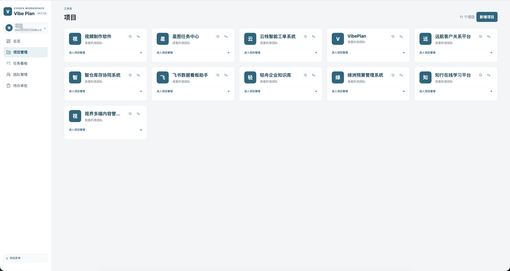
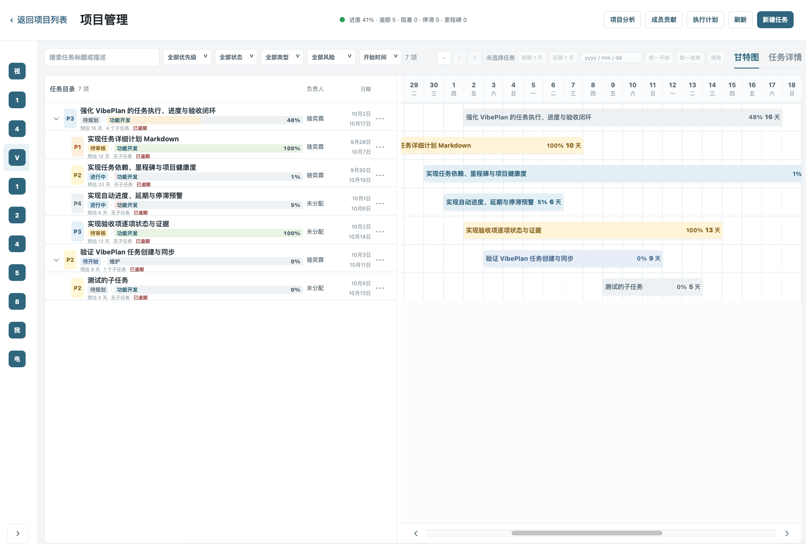
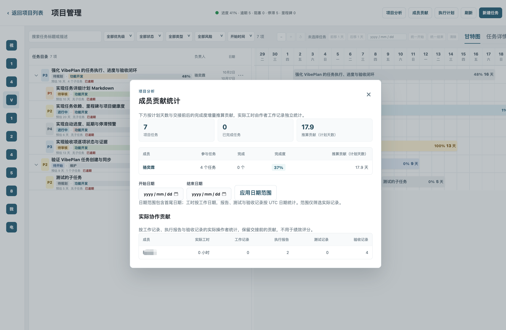

# Vibe Plan

[中文](README.md) · English

**Manage your task progress with AI.**

Vibe Plan is a task management platform for AI-assisted development. It connects Codex and Claude Code to your project tasks, so AI can help create tasks, understand requirements, implement changes, update progress, and report changed files and test results.

Use the web interface to manage projects, tasks, progress, reviews, and execution records, and view member workloads, actual work hours, task completion, and code contribution statistics. The `vibeplan` CLI keeps your local Git project in sync with the web platform, giving you visibility into what AI is working on and what it has delivered.

> [!TIP]
> **🤝 Sponsor · [TokenFLS GPT API Gateway](https://www.tokenfls.com)**
>
> **More room to build with AI. Less spent on API calls. No reduced model intelligence. No overload.**
>
> Limited developer access keeps the focus on service quality and stability. **RMB ¥1 buys US $1 in usage credits**, with low model billing multipliers to help your development budget go further.
>
> [Explore TokenFLS models and pricing →](https://www.tokenfls.com)

## Project screenshots

Explore project management, task tracking, and collaboration analytics in the web interface:

<p align="center">
  
  
  
</p>

Use online: [https://vibeplan.szxinjin.cn](https://vibeplan.szxinjin.cn) · Free forever for personal use.

## License

Individuals and organizations may use, modify, and privately deploy this project for free. Commercial operation, sale, commercial hosting, or commercial SaaS use of this project or modified versions is prohibited. See [LICENSE](LICENSE) for the full terms. Contact the copyright holder for commercial licensing.

## Quick start

### 1. Create an account and project

Open [Vibe Plan](https://vibeplan.szxinjin.cn/projects), register and sign in, then create or select a project. Keep its project ID.

### 2. Install the CLI

Node.js 22 or newer is required:

```bash
npm install --global @vibeplan/cli@latest
vibeplan --version
```

### 3. Sign in and bind the local project

Run these commands in the root of the local Git project:

```bash
vibeplan login
vibeplan init --project-id PROJECT_ID
```

Replace `PROJECT_ID` with the ID from the website. Check the current login with `vibeplan whoami`.

### 4. Install assistant rules and start synchronization

For Codex:

```bash
vibeplan install-codex
```

For Claude Code:

```bash
vibeplan install-claude
```

Start synchronization in the same project directory:

```bash
vibeplan start
```

Once you see the synchronization logs, tell Codex or Claude Code: “Add the tasks above to Vibe Plan” or “Implement Vibe Plan task TASK_ID.” See [user-guide.md](user-guide.md) for the full guide (in Chinese).

Common daemon commands:

```bash
vibeplan status
vibeplan logs --follow
vibeplan stop
```

## Local development

To develop Vibe Plan itself, install Node.js 22, pnpm 11, and Docker:

```bash
./start.sh
```

- Web: <http://localhost:5173>
- API: <http://localhost:4000>

## Build and test

```bash
pnpm lint
pnpm test
pnpm build
```

## Publish the npm CLI

Configure the npm token:

```bash
cp scripts/tencent-credentials.env.example scripts/tencent-credentials.env
# Set NPM_TOKEN in the file
```

Automatically increment the patch version and publish both packages:

```bash
scripts/publish-npm.sh
```

Publish an explicit version:

```bash
scripts/publish-npm.sh 0.2.0
```

The publish order is `@vibeplan/templates` followed by `@vibeplan/cli`. After publishing, the script exits without waiting for npm registry propagation.

## Publish container images

Set `TENCENT_CCR_USERNAME` and `TENCENT_CCR_PASSWORD` in `scripts/tencent-credentials.env`, then run:

```bash
scripts/build-and-push-tencent.sh
```

You can also specify a version or publish npm at the same time:

```bash
scripts/build-and-push-tencent.sh 0.2.0
scripts/build-and-push-tencent.sh --publish-npm
```

Deployment files are in `deploy/server/`.

## Command reference

Start local development:

```bash
./start.sh
```

Build and publish images, with an automatic patch increment or an explicit version:

```bash
scripts/build-and-push-tencent.sh
scripts/build-and-push-tencent.sh 0.1.10
```

Publish npm packages with an automatic patch increment or an explicit version:

```bash
scripts/publish-npm.sh
scripts/publish-npm.sh 0.1.10
```

Set `NPM_TOKEN` in `scripts/tencent-credentials.env`. If it expires or stops working, generate a new token on npm and update the file.

Install the latest CLI:

```bash
npm install --global @vibeplan/cli@latest
```

Create a project on the website, copy the initialization command from its project card, and run it in your local Git project. Then install the Codex rules and start synchronization:

```bash
vibeplan init --project-id PROJECT_ID
vibeplan install-codex
vibeplan start
```

To replace existing Codex rules when needed:

```bash
vibeplan install-codex --force
```

## Join the community

Scan the QR code with WeChat to add us as a contact. Include “vibePlan” in your friend request to receive an invitation to the community group.


