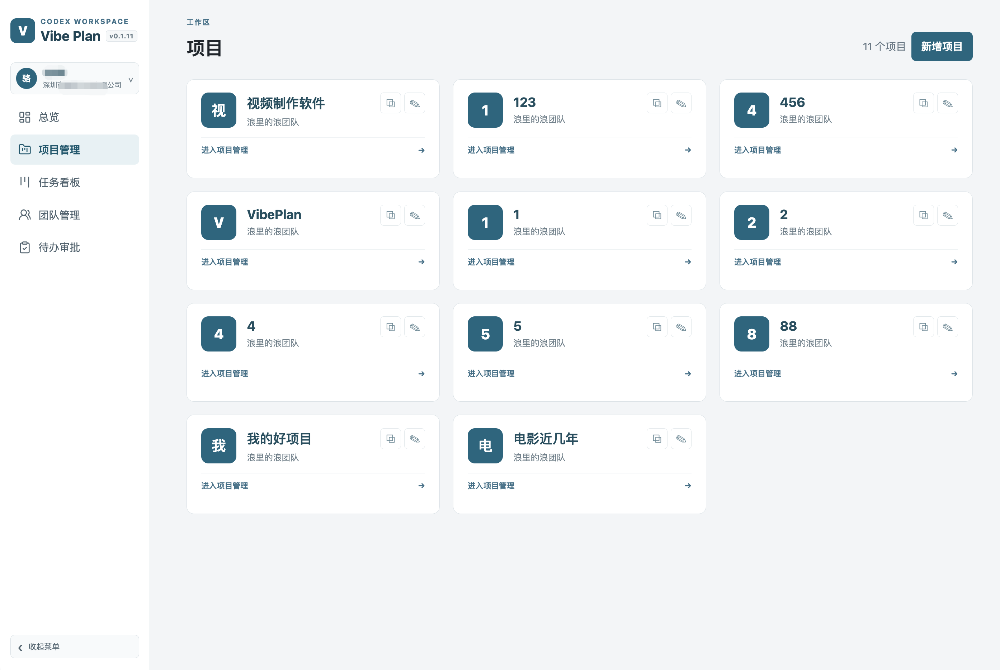
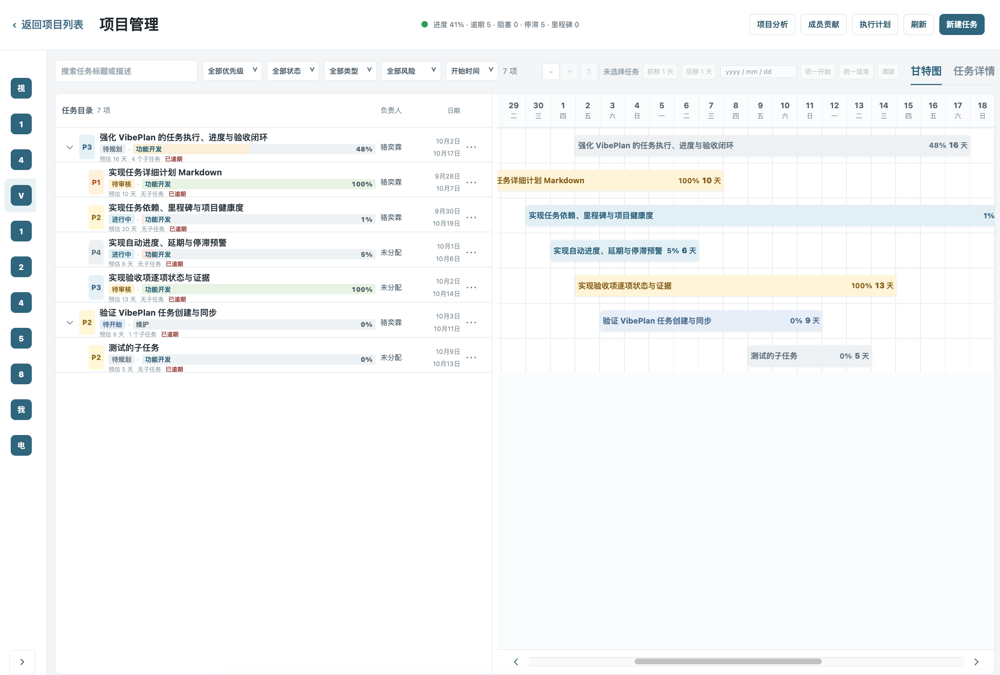
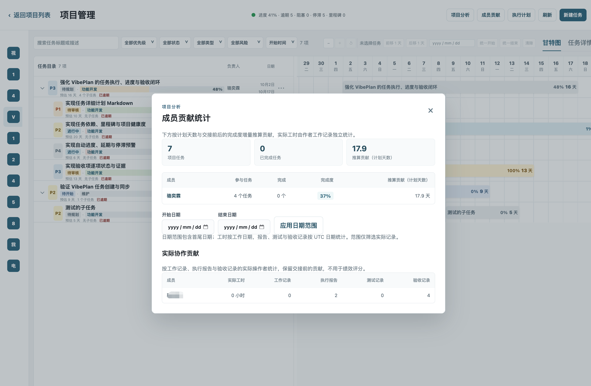

# Vibe Plan

中文 · [English](README.en.md)

**用 AI 管理你的任务进度。**

Vibe Plan 是一个面向 AI 编程协作的任务管理平台。它把 Codex、Claude Code 与项目任务连接起来，让 AI 参与完整的任务流程：创建任务、理解需求、执行开发、更新进度，并提交变更文件和测试结果。

团队可以通过 Web 可视化管理项目、任务、进度、验收和执行记录，并查看成员负载、实际工时、任务完成情况和代码贡献统计；开发者在本地 Git 项目中使用 `vibeplan` CLI，与 Web 端保持同步。这样，AI 负责协助完成工作，人可以随时查看方向、进展和结果。

## 项目界面

项目管理、任务跟踪和协作分析都可以在 Web 页面中直观查看：

<p align="center">
  
  
  
</p>

在线使用：[https://vibeplan.szxinjin.cn](https://vibeplan.szxinjin.cn) · 个人永久免费。

## 使用许可

本项目允许个人和企业免费使用、修改及私有化部署，但禁止将本项目或其修改版本用于商业运营、商业销售、商业托管或商业 SaaS 服务。完整条款见 [LICENSE](LICENSE)；如需商业授权，请联系版权持有人。

## 使用教程

### 1. 注册账号并创建项目

打开 [Vibe Plan](https://vibeplan.szxinjin.cn/projects)，注册并登录账号，然后创建或选择一个项目，记下项目 ID。

### 2. 安装 CLI

要求 Node.js 22 或更高版本：

```bash
npm install --global @vibeplan/cli@latest
vibeplan --version
```

### 3. 登录并绑定本地项目

进入要开发的本地 Git 项目根目录：

```bash
vibeplan login
vibeplan init --project-id PROJECT_ID
```

将 `PROJECT_ID` 换成网站中的实际项目 ID。`vibeplan whoami` 可以检查登录状态。

### 4. 安装编码助手规则并启动同步

Codex 用户：

```bash
vibeplan install-codex
```

Claude Code 用户：

```bash
vibeplan install-claude
```

然后启动当前项目的同步后台：

```bash
vibeplan start
```

看到同步日志后，就可以在 Codex 或 Claude Code 中说“把上面的任务加入 Vibe Plan”或“实现 Vibe Plan 任务 TASK_ID”。详细操作见 [user-guide.md](user-guide.md)。

常用后台命令：

```bash
vibeplan status
vibeplan logs --follow
vibeplan stop
```

## 本地开发

开发 Vibe Plan 本身需要 Node.js 22、pnpm 11 和 Docker：

```bash
./start.sh
```

- Web：<http://localhost:5173>
- API：<http://localhost:4000>

## 构建与测试

```bash
pnpm lint
pnpm test
pnpm build
```

## 发布 npm CLI

配置 token：

```bash
cp scripts/tencent-credentials.env.example scripts/tencent-credentials.env
# 在文件中填写 NPM_TOKEN
```

自动递增 patch 版本并发布两个包：

```bash
scripts/publish-npm.sh
```

手动指定版本：

```bash
scripts/publish-npm.sh 0.2.0
```

发布顺序：`@vibeplan/templates` → `@vibeplan/cli`。发布成功后脚本直接结束，不等待 npm registry 延迟同步。

## 发布镜像

在 `scripts/tencent-credentials.env` 中填写 `TENCENT_CCR_USERNAME` 和 `TENCENT_CCR_PASSWORD`：

```bash
scripts/build-and-push-tencent.sh
```

也可以手动指定版本，或同时发布 npm：

```bash
scripts/build-and-push-tencent.sh 0.2.0
scripts/build-and-push-tencent.sh --publish-npm
```

镜像部署文件位于 `deploy/server/`。


# 开始调试

./start.sh

# 打包镜像 不加版本号会自增
scripts/build-and-push-tencent.sh
scripts/build-and-push-tencent.sh 0.1.10

# 发布npm (token 不行就要换) 在 scripts/tencent-credentials.env 中填写 NPM_TOKEN (会过期，过期之后，去官方，再拿一下。)
# 不加版本号会自增
scripts/publish-npm.sh 
scripts/publish-npm.sh 0.1.10

# 本机安装npm

npm install --global @vibeplan/cli@latest

# 快速使用 
- 去网站项目新建项目，在项目卡片里复制 vibeplan init --project-id c7ec81ab-bf8c-46ec-bc4f-f6669a417e0e 到终端运行初始绑定项目。
- 安装codex支持
vibeplan install-codex
vibeplan install-codex --force
- 终端运行
vibeplan start

