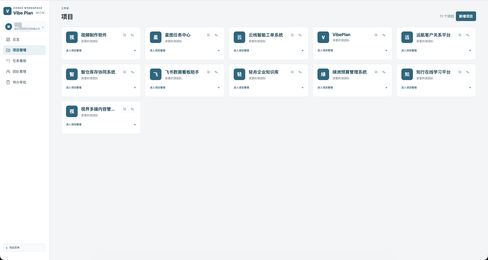
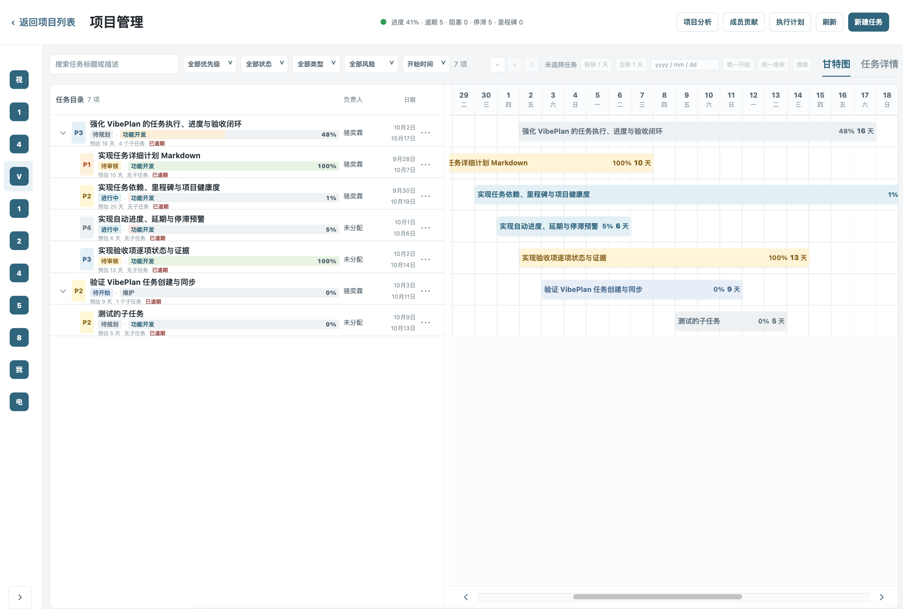
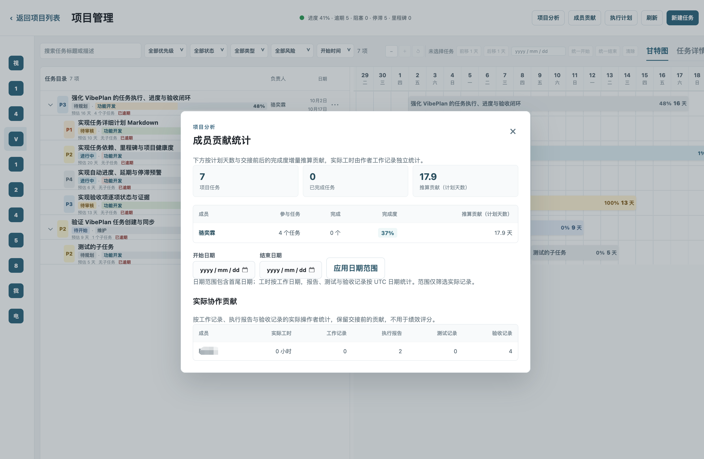

<!-- CSDN 标题：AI 写完代码以后，任务真的完成了吗？用 Vibe Plan 把 AI 开发变成可验收的闭环 -->

> AI 写代码越来越快，但“交付”并没有随之变简单。真正的难题是：当 AI 说任务完成时，我们如何确认它完成了什么、验证了什么，以及是否真的可以进入下一步？



过去，开发进度的核心问题通常是“代码什么时候能写完”。现在，使用 Codex、Claude Code 等 AI 编程助手后，代码可能在一次长会话里就被实现了。可一个新的问题随之出现：**AI 完成代码，不等于任务已经完成。**

需求可能还散在聊天记录里；AI 的实施计划没有留下来；测试命令和结果停留在本地终端；负责人需要反复询问“现在做到哪了”；最后的验收又变成一句模糊的“看起来没问题”。

这并不是 AI 不够强，而是 AI 编程缺少一条可追溯的任务执行链路。

## AI 编程中的“完成”为什么不可靠

想象一个很常见的场景：你把一个功能交给 AI，几个小时后它告诉你“已经完成”。

此时你真正需要知道的，往往不是“代码写了吗”，而是下面这些问题：

- 这次改动是否覆盖了最初的需求和边界？
- AI 采用了什么实施方案，风险在哪里？
- 修改了哪些文件？
- 跑了哪些测试，测试是否通过？
- 验收标准是否逐项确认？

如果这些信息没有沉淀，“完成”就只是一句结论，而不是可复核的事实。开发者需要花时间解释，负责人需要花时间追问，团队仍然无法据此判断能否发布。

Vibe Plan 要补上的，正是这段断裂的交接：让任务从需求开始，到 AI 执行、提交证据、人工验收为止，始终有清晰记录。

## 不是再做一个看板，而是让 AI 的工作可追溯

Vibe Plan 面向 AI 编程协作，把 Web 端项目管理与本地 Git 仓库、Codex 或 Claude Code 连接起来。它关注的不是“给任务换一个列表”，而是让一个任务拥有完整的执行闭环：

```text
任务与验收标准
        ↓
AI 生成并提交执行计划
        ↓
编码、进度同步、改动文件与测试结果
        ↓
人工逐项验收，决定是否完成
```

这样做的意义很直接：AI 可以持续执行，而人始终能看到方向、进展和交付依据。



## 用一个任务走完这条链路

下面用一个“新增任务验收能力”的功能为例，看看一项 AI 协作任务如何从开始走到真正可交付。

### 1. 先定义任务，而不是直接让 AI 开始写

任务中应该写清楚目标、范围和验收标准。例如，不只写“增加验收功能”，而是明确：验收项有哪些状态、谁可以提交结果、什么情况下任务不能完成。

这一步给 AI 一个准确边界，也给后续验收留下共同依据。需求变更时，团队讨论的是具体任务内容，而不是回忆某段聊天记录。

### 2. 让 AI 把计划变成可读、可审阅的文档

在动手前，AI 可以为任务提交 Markdown 计划：目标、实现步骤、预计修改的模块、风险与测试方案。

这份计划不是形式化文档，而是一次低成本的对齐。开发者能提前发现遗漏，负责人也能理解 AI 要解决什么问题。计划会同步到本地 `.vibe/tasks/<TASK_ID>.plan.md`，后续会话也能读到同一份上下文。

### 3. 执行过程不只留下代码，还留下证据

完成开发后，真正有价值的记录不止是 Git diff。任务还应保存：改动文件、实际执行的测试命令、测试结果、风险和剩余问题。

于是，“这个功能完成了吗”不再依赖某个人的记忆。任何参与者都能快速看到 AI 做了什么，以及它用什么证据支持交付结论。

### 4. 由人完成最后的验收

AI 可以实现和自检，但是否符合业务预期、是否应该合并或发布，仍应由人来判断。

Vibe Plan 支持按验收项记录结果、评论、验收人、时间和证据。关键验收项未通过时，任务不会被误标为完成。这样既保留了 AI 的效率，也保留了团队对质量和决策的控制权。



## 对开发者和负责人，价值并不相同

对开发者来说，Vibe Plan 减少的是被打断解释进度的次数。任务、计划、测试和改动记录都在同一处，AI 也能获得更稳定的任务上下文。

对负责人来说，它提供的是可验证的项目视图：不是“这项任务大概完成了 80%”，而是能看到计划是否存在、测试是否通过、是否有风险、验收项是否全部满足。

对团队来说，最重要的是建立一个共识：**AI 的输出不是终点，经过证据和验收的交付才是。**

## 5 分钟跑通第一个 AI 任务

Vibe Plan 提供个人免费使用。先在 [Vibe Plan](https://vibeplan.szxinjin.cn/projects) 创建项目并获取项目 ID，然后在本地 Git 项目根目录运行：

```bash
npm install --global @vibeplan/cli@latest
vibeplan login
vibeplan init --project-id PROJECT_ID
vibeplan install-codex
vibeplan start
```

如果你使用 Claude Code，将最后的安装命令替换为：

```bash
vibeplan install-claude
```

随后，在 Codex 或 Claude Code 中让 AI “把上面的任务加入 Vibe Plan”，或者直接要求它实现某个 Vibe Plan 任务。你会得到的不只是一次代码生成，而是一条从需求到验收都可追溯的交付记录。

## 结语

AI 正在改变写代码的速度，但团队协作真正需要解决的是交付的可信度。

不必一开始就迁移所有项目。选一个正在开发的小功能，用 Vibe Plan 跑完一次“任务、计划、执行、证据、验收”的闭环。等到 AI 的“已经完成”不再只是一句话，而是每个人都能检查的结果，AI 编程才真正融入了团队的工作方式。

**立即体验：[Vibe Plan](https://vibeplan.szxinjin.cn)**
